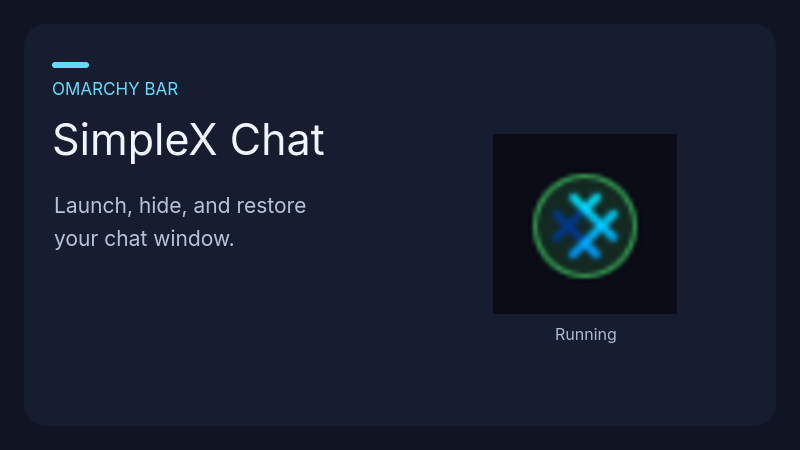

# SimpleX Chat for Omarchy

Keep SimpleX Chat one click away on Wayland. The bar badge launches the desktop app, moves its window to a hidden Hyprland workspace, or brings it back to the workspace you're using. The green ring shows that the desktop window is running, even when hidden.



## Install

Requires Omarchy 4.x with Quickshell, Hyprland 0.55 or later, `hyprctl`, `jq`, `setsid`, and the [SimpleX Chat desktop app](https://simplex.chat/). The widget looks for `simplex-desktop` on your `PATH`, then falls back to `~/simplex`.

```sh
omarchy plugin add https://github.com/CallMeBakugo/omarchy-simplex.git --enable
```

For another installation path, point the widget at the executable:

```sh
omarchy bar set bakugo.simplex appPath /path/to/simplex
```

If the package uses a different Hyprland window class, set `windowClass`. The default is `chat-simplex-desktop-MainKt`.

## Use

Left-click to launch, hide, or restore the window. Right-click to refresh its running state. Hidden windows stay on `special:simplex`, so SimpleX can continue receiving messages. The widget reads compositor window state and does not read messages.

## Remove

If SimpleX is hidden, click the badge once to bring the window back before removing the widget.

```sh
omarchy plugin remove bakugo.simplex --yes
```

[MIT license](LICENSE).
